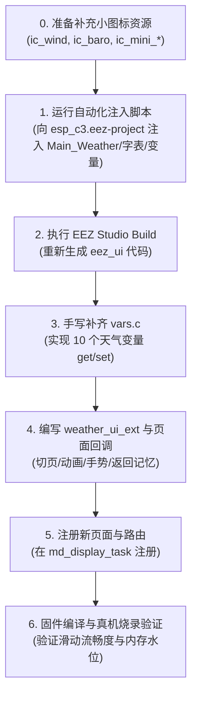

# ESP-C3 天气应用 UI 设计方案 v1.0（320×240 横屏 · EEZ Studio 主导 + 双Tile全景预报版）

| 项 | 值 |
|---|---|
| 文档类型 | UI 设计规格书（参数级，供 AI 与嵌入式工程师直接实现） |
| 目标硬件 | ST7789 320×240 SPI 屏（`dispTFT_WIDTH/HEIGHT`）+ FT6336U 电容触摸（`lv_port_indev.c`） |
| UI 框架 | LVGL 9.4（`managed_components/lvgl__lvgl`） |
| 调度架构 | UniDisplay（`Middlewares/UniDisplay` + `Hardware/MD_Display`） |
| 页面载体 | **新增页面 `PAGE_ID_APP_WEATHER`（`md_display_page_weather.c`）**，在 `G_tPageWork` 主页2网格点击进入 |
| **交付形态** | **EEZ Studio 工程全面主导（SOP-A 规范路径）**：承担全部静态布局、卡片容器、共享样式（含 Pressed 态、圆角 10/12、深色质感 `#242831` / `#1B1E23`）、子集字体、静态图标、气象序列帧图集与 Native 变量绑定；`vars.c` 手写数据桥；`user_ui/` 仅保留最薄胶水层（Tileview 逻辑/手势指示点联动、信号格显隐、LVGL `lv_anim` 序列帧与返回主页事件监听） |
| EEZ 工程 | `Hardware/MD_Display/eez_esp_c3_project/esp_c3.eez-project`，**新增 Screen `Main_Weather`**（与 `Main_Work` 命名风格一致） |
| 组件复用 | **直接复用 EEZ 已有 User Widget**：`page_state`（底部翻页指示点）+ `wifi_icom`（顶栏 5 阶信号柱） |
| 设计来源 | [weather_app_ui_design_v1.0.html](file:///g:/2-User_Projects/11-ESP/ESP-C3/Docs/weather_app_ui_design_v1.0.html) |
| 设计日期 | 2026-10-16（v1.0 完善修订版） |

> **架构设计准则**：严格遵循 [eez-uni-display SKILL.md](file:///g:/2-User_Projects/11-ESP/ESP-C3/.agents/skills/eez-uni-display/SKILL.md) 的硬性红线要求。`eez_ui/` 目录文件除 `vars.c` 外保持只读；页面回调中无阻塞调用；通用调度核心（`Middlewares/UniDisplay`）零项目符号侵入；页面只消费原子快照 `DispDataSnapshot_T`；复用已有 8 态天气 8 帧序列图资源实现零 Flash 增量动效；**返回主页时显式保持 Tile 1 上下文记忆**。

---

## 1. 总体规格

### 1.1 基本参数

| 参数 | 值 | 说明 |
|---|---|---|
| 分辨率 | 320(H) × 240(V) 横屏 | RGB565，ST7789 驱动 |
| 页面载体 | EEZ Screen `Main_Weather`（生成 `SCREEN_ID_MAIN_WEATHER` 与 `objects.main_weather`） | 单屏承载固定导航顶栏 + 双 Tile 视口 + 底部悬浮指示点 |
| 页面结构 | 固定导航栏（32px）+ `weather_tileview`（208px，双 Tile）+ 底部悬浮指示点 | Tile 0（今日核心气象与微矩阵）/ Tile 1（逐时趋势与3日预报） |
| 交互触发 | A. 手势滑动（Tileview 原生左右横滑） B. 顶部 [主页] 按钮返回 C. 实体按键短按切Tile/长按返回 | 统一 250ms ease-out 平滑过渡 |
| 天气动效方案 | **复用主页既有 8 态 × 8 帧天气序列图集（`images.h`）→ `user_ui` ManualTick 驱动** | 零 Flash 额外开销，48×48 像素精确匹配 Hero 卡片，滑动中自动挂起 |
| 页面帧周期 | `usRefreshMs = 33`（30FPS） | 维持 UniDisplay 标准帧周期；触摸由 `dispINDEV_POLL_PERIOD_MS=16` 保证流畅 |
| 数据模式 | 帧快照消费（`DispDataSnapshot_T`）+ EEZ Native 变量数据桥 + Tile 1 结构体直驱 | 渲染链只读 `p_data`，Tile 0 经 `vars.c` 自动刷新，Tile 1 低频直驱防变量爆炸 |

### 1.2 布局总骨架（320×240 像素严格对齐）

```text
(0,0)   ┌──────────────────────────────────────────────┐ (320,0)
│ [‹主页]         北京 (朝阳)        [•已同步] [wifi_icom]│ ← 顶栏 y=0..31（高32px，固定不随滑动滚动）
(0,31)  ├──────────────────────────────────────────────┤ ← 1px 底边框分隔线（#343A44）
│ (0,32)┌────────────────────────────────────────────┐ │
│       │ Tile 0: 今日核心与环境微矩阵 (y=32..239)   │ │
│       │  ┌──────────────────────────────────────┐  │ │
│       │  │ [48x48序列帧] 16.6°C  体感 15.8°C     │  │ │ ← Hero卡片 y=38..123 (tile内 y=6, 296×86)
│       │  │ 阴天 [白天]          11°~19° 宜穿外套 │  │ │
│       │  └──────────────────────────────────────┘  │ │
│       │  ┌───────────────┐      ┌────────────────┐ │ │
│       │  │ 风速 东北风38° │      │ 室内温湿 Gxhtc3│ │ │ ← 2x2微矩阵 y=132..229 (tile内 y=100, 296×98)
│       │  │ 4.4 km/h      │      │ 25.5° / 45%    │ │ │   4张 144×47 卡片，间距 8px
│       │  ├───────────────┤      ├────────────────┤ │ │
│       │  │ 相对湿度 润泽 │      │ 大气压强 平稳  │ │ │
│       │  │ 68 %RH        │      │ 1016 hPa       │ │ │
│       │  └───────────────┘      └────────────────┘ │ │
│       ├────────────────────────────────────────────┤ │
│       │ Tile 1: 逐时趋势与多日预报 (横滑切入)       │ │
│       │  24 小时气温趋势             Open-Meteo 模型│ │ ← 小标题 y=36..51 (tile内 y=4)
│       │  ┌──────────────────────────────────────┐  │ │
│       │  │ 现在    12:00   15:00   18:00   21:00│  │ │ ← 逐时柱状容器 y=54..133 (tile内 y=22, 296×80)
│       │  │ 16.6°   18.2°   19.0°   15.5°   13.2°│  │ │   5组微型柱状图 + 图标 + 温度
│       │  └──────────────────────────────────────┘  │ │
│       │  未来 3 日预报                  日均温差    │ │ ← 小标题 y=138..153 (tile内 y=106)
│       │  ┌──────────────────────────────────────┐  │ │
│       │  │ 明天   [icon] 晴朗升温 · 紫外线中等 21° 12°│  │ │ ← 3行预报条目 y=156..225 (各 296×30, 间隙 4px)
│       │  └──────────────────────────────────────┘  │ │
│       └────────────────────────────────────────────┘ │
│                     [page_state]                     │ ← 翻页指示点 y=230 (复用 User Widget, 居中于 X=160)
(0,240) └──────────────────────────────────────────────┘
```

- **顶部导航栏（`y = 0..31`）**：高 32px，直接挂在 Screen 根对象下，背景 `#262B33`（92% 不透明），含返回按钮、居中城市、对时徽章及复用的 `wifi_icom` User Widget；
- **双面板视口区（`y = 32..239`）**：主视口高 208px，为 `weather_tileview` 控件，挂载 `tile_weather_today`（Tile 0）与 `tile_weather_forecast`（Tile 1）；
- **底部翻页指示点（`y = 230`）**：直接复用 `page_state` User Widget 挂在 Screen 根层最前侧（Z-order 位于 `weather_tileview` 之上），激活态胶囊 `12×6px`（`#E3E6EA`），未激活态圆点 `6×6px`（`#5A6068`），间距 `4px`，居中于 `X = 160`。

### 1.3 职责分工（EEZ Studio 主导 + user_ui 胶水层）

| 功能模块 | 归属 | 实现方式 |
|---|---|---|
| 全部布局、卡片容器、2×2网格、逐时微框、多日预报行 | **EEZ Studio 工程** | 搭建于 `Main_Weather` Screen |
| 底部指示点 (`page_state`) 与信号柱条 (`wifi_icom`) | **EEZ Studio User Widget** | **直接复用既有 User Widget**，避免重复造轮子 |
| 顶栏返回按钮、Hero 卡片、指标卡按压反馈（`PRESSED`） | **EEZ Studio 工程** | 共享样式 `st_home_card` / `st_weather_btn`（含 Default/Pressed 双态） |
| 字体子集补充编译（+39个汉字）与图片/图集打包 | **EEZ Studio 工程** | 在 `fonts` 中追加字符，Build 自动生成 `eez_ui/fonts.c` |
| Tile 0 动态文本（城市、气温数值、天气描述、昼夜标签、体感温差、生活贴士、4项微指标） | **EEZ Native 变量 + `vars.c`** | `set_var_xxx` → `ui_tick()` 自动比对刷新（严格控制在 10 个变量内） |
| Tile 1 逐时柱状图高度、时刻、预报条目文本 | **user_ui（`weather_ui_ext.c`）** | 低频直驱 `objects.*`，杜绝变量过度膨胀（不建 Native 变量） |
| 8 态天气序列帧逐帧轮播 | **user_ui（`weather_ui_ext.c`）** | 操作 EEZ 生成的 `objects.weather_hero_anim_img` 切换帧索引，滑动期间自动挂起 |
| 页面路由接入、返回主页2记忆切页、实体按键事件消费 | **页面控制件（`md_display_page_weather.c`）** | UniDisplay `DispPage_T` 契约回调，返回时调 `vHomeUi_RequestTile(1)` 维持主页2网格 |

---

## 2. 全局设计参数

### 2.1 颜色表（EEZ Studio 样式表配置）

| 语义 | 颜色值 | 用途 |
|---|---|---|
| 根背景色 | `#1B1E23` | Screen `Main_Weather` 背景 |
| 视口面板背景 | `#1B1E23` | Tile 0 / Tile 1 页面底层背景 |
| 顶栏背景 / 底边框 | `#262B33`（92% 不透明） / `#343A44` | 顶部导航条与 y=31 分隔线 |
| 返回按钮背景 / 按压背景 | `rgba(255,255,255,0.06)` / `rgba(255,255,255,0.16)` | 返回按键 Default / Pressed 态 |
| 卡片默认背景 / 边框 | `#242831` / `#363D4A`（1px，圆角 10/12） | Hero 卡片、2×2 子卡片、逐时与预报卡片 |
| 卡片按压背景 / 边框 | `#2B303B` / `#4C5669` | Hero 卡片 Pressed 态反馈 |
| 主文字 / 大字气温 | `#FFFFFF` / `#F8FAFC` | 顶栏城市、Hero 气温数值、各区块标题 |
| 次要文字 / 单位文字 | `#94A3B8` | 卡片副标题、`°C`/`%RH`/`km/h`/`hPa` 单位 |
| 辅助弱化文字 | `#64748B` | 预报最低气温、熄灭信号格 |
| 白天标签背景 / 文字 | `rgba(255,214,10,0.16)` / `#FFD60A` | Hero 卡片「白天」标签 |
| 夜间标签背景 / 文字 | `rgba(196,181,253,0.18)` / `#C4B5FD` | Hero 卡片「夜间」标签 |
| 雨雪标签背景 / 文字 | `rgba(92,225,255,0.16)` / `#5CE1FF` | 雨雪天气或高湿环境标签 |
| 生活指数胶囊背景 / 边框 / 文字 | `rgba(56,189,248,0.10)` / `rgba(56,189,248,0.25)` / `#38BDF8` | Hero 卡片「宜穿外套」胶囊 |
| 对时正常点亮色 | `#4ADE80`（翠绿） | 对时状态圆点、同步文本 |
| 翻页指示点激活色 / 未激活色 | `#E3E6EA` / `#5A6068` | 底部滑动指示胶囊与圆点（来自 `page_state`） |

---

### 2.2 字体分配与增量字符集清单（精确补齐，消除缺字）

> [!IMPORTANT]
> **字体补齐原则**：[esp_c3.eez-project](file:///g:/2-User_Projects/11-ESP/ESP-C3/Hardware/MD_Display/eez_esp_c3_project/esp_c3.eez-project) 现有 `home_cn_16` 仅 11 字，`home_cn_12` 仅 48 字。为确保天气应用中的文字不出现空白方块，必须在 EEZ 字库配置中追加以下增量字符集，从已有的 `fonts/PingFangSC-Regular.ttf` 中重新提取打包：

| 字体名（EEZ） | 字号 | 原始符号集（已存在） | **本次天气应用增量追加字符集** | 最终符号总量 | 估算 Flash 增量 |
|---|---|---|---|---|---|
| `home_num_32` | 32px | `0123456789.-` | *(无需增加)* | 12 字符 | 0 KB |
| `home_cn_16` | 16px | `晴多云阴小大雨雪雾·°` (11字) | **`北京朝阳`** (4字) | 15 字符 | +0.4 KB |
| `home_cn_12` | 12px | 基础温湿度与主页文字 (48字) | **`页白夜穿外套防晒补水携带具风速东南西北微相对泽压强海平面稳现在明天后大转升朗紫线降率户外出行模型趋势预报差均`** (46字) | 94 字符 | +3.8 KB |
| `lv_font_montserrat_10` | 10px | LVGL 原生 ASCII 内置字库 | *(内置字库，支持对时标签与逐时时刻)* | 完整 ASCII | 0 KB |

- **总增量成本**：仅增加 **~4.2 KB Flash**，完全在 ESP32-C3 4MB Flash 的宽裕空间内，彻底消除文字渲染缺失隐患。

---

### 2.3 图片与动效图集清单（既有复用 + 必要补齐）

| 类别 | 符号名称 | 尺寸 | 来源状态 | 说明 |
|---|---|---|---|---|
| **气象动效序列帧** | `img_anim_sunny_00` ~ `07` | 48×48 (8帧) | **已存在（复用）** | 晴天动效（太阳金核 + 45° 循环光芒） |
| **气象动效序列帧** | `img_anim_cloudy_00` ~ `07` | 48×48 (8帧) | **已存在（复用）** | 多云动效（太阳与云朵反向微浮动） |
| **气象动效序列帧** | `img_anim_overcast_00` ~ `07` | 48×48 (8帧) | **已存在（复用）** | 阴天动效（前后双云差速微漂移） |
| **气象动效序列帧** | `img_anim_rain_00` ~ `07` | 48×48 (8帧) | **已存在（复用）** | 雨天动效（云层 + 三阶雨滴下落循环） |
| **气象动效序列帧** | `img_anim_night_sunny_00` ~ `07` | 48×48 (8帧) | **已存在（复用）** | 晴空夜（月牙微浮 + 星星闪烁） |
| **气象动效序列帧** | `img_anim_night_cloudy_00` ~ `07` | 48×48 (8帧) | **已存在（复用）** | 多云夜（月牙 + 云朵漂移） |
| **气象动效序列帧** | `img_anim_night_overcast_00` ~ `07` | 48×48 (8帧) | **已存在（复用）** | 阴夜（隐月 + 暗云差速漂移） |
| **气象动效序列帧** | `img_anim_night_rain_00` ~ `07` | 48×48 (8帧) | **已存在（复用）** | 雨夜（隐月 + 暗云 + 雨滴循环） |
| 传感器图标 | `img_ic_temp` / `img_ic_humi` | 20×20 | **已存在（复用）** | 室内温湿度微卡片内嵌图标 |
| **微矩阵图标** | `img_ic_wind` | 20×20 | **新增补齐** | 浅蓝 `#38BDF8` 风标图标，用于风向风速卡 |
| **微矩阵图标** | `img_ic_baro` | 20×20 | **新增补齐** | 紫罗兰 `#C4B5FD` 表盘图标，用于大气压强卡 |
| **逐时/预报迷你图标**| `img_ic_mini_sunny` / `cloudy` / `overcast` / `rain` / `night` | 16×16 (5张) | **新增补齐** | 专为 24H 趋势和未来 3 日预报提供，消除运行时缩放开销 |

---

## 3. EEZ Studio 控件树规格（Screen `Main_Weather`）

### 3.1 顶部导航栏（Screen 直接子对象，绝对坐标 `y = 0..31`）

> **组件复用优化**：右上角的 WiFi 信号柱条直接复用既有的 `wifi_icom` User Widget，EEZ 编译后自动生成 `objects.weather_top_bar__wifi_icom`，完全复用主页的 5 阶信号设色逻辑。

| 对象名 | EEZ 控件类型 | 坐标 (x,y) | 尺寸 | 样式与属性 | 动态来源 / 事件 |
|---|---|---|---|---|---|
| `weather_nav_bar` | Container | (0, 0) | 320×32 | 背景 `#262B33`（92%）、底边 1px `#343A44` | 静态顶栏容器 |
| `btn_weather_back` | Panel | (6, 3) | 48×26 | 圆角 6、背景 `rgba(255,255,255,0.06)`、按压变深 | 点击事件调 `vDisp_RequestPage(PAGE_ID_WORK)` |
| `lbl_back_icon` | Label | (10, 7) | 12×18 | `ui_font_home_cn_12`、`#E2E8F0`、静态文本「‹」 | 静态返回箭头 |
| `lbl_back_text` | Label | (22, 7) | 28×18 | `ui_font_home_cn_12`、`#E2E8F0`、静态文本「主页」 | 静态返回文本 |
| `weather_nav_title` | Label | (100, 6) | 120×20 | `ui_font_home_cn_16`、`#FFFFFF`、居中对齐 | 绑定变量 `weather_city_name`（默认「北京 (朝阳)」） |
| `weather_sync_badge` | Container | (224, 7) | 44×18 | 圆角 9、背景 `rgba(74,222,128,0.12)`、边框 1px | 对时状态外框 |
| `weather_sync_dot` | Object | (229, 13) | 5×5 | 圆角 3；已对时 `#4ADE80` / 未对时 `#5A6068` | `user_ui` 设色（带比对缓存） |
| `weather_sync_text` | Label | (237, 8) | 28×16 | `lv_font_montserrat_10`、`#4ADE80`、静态「同步」 | 静态文本 |
| *(嵌入 User Widget)* | `UserWidget: wifi_icom` | (276, 5) | 36×22 | 内部包含 `sig_bar_0` ~ `sig_bar_4` | **复用主页信号组件**，`user_ui` 统一设色 |

---

### 3.2 视口容器与翻页指示点（Screen 直接子对象）

> **组件复用优化**：底部翻页指示点直接复用既有的 `page_state` User Widget，挂载在根层 `(149, 230)`，完全复用主页的胶囊与圆点切换逻辑。

| 对象名 | EEZ 控件类型 | 坐标 (x,y) | 尺寸 | 样式与属性 | 说明 |
|---|---|---|---|---|---|
| `weather_tileview` | Tileview | (0, 32) | 320×208 | 水平滚动（`LV_DIR_HOR`），隐藏原生滚动条 | 承载 Tile 0 与 Tile 1 |
| `tile_weather_today` | TileViewTile | col 0, row 0 | 320×208 | 背景 `#1B1E23` | 今日全景与环境微矩阵 |
| `tile_weather_forecast` | TileViewTile | col 1, row 0 | 320×208 | 背景 `#1B1E23` | 24H 趋势与未来 3 日预报 |
| *(嵌入 User Widget)* | `UserWidget: page_state` | (149, 230) | 22×6 | 内部包含 `page_dot_0` 与 `page_dot_1` | **复用主页指示点组件**，自动同步切页胶囊态 |

---

### 3.3 Tile 0 布局规格（今日核心气象与环境微矩阵）

#### ① 核心气象 Hero 卡片 `card_weather_hero`（tile 内坐标 `(12, 6)`，尺寸 `296×86`）

| 对象名 | EEZ 控件 | 坐标(卡内) | 尺寸 | 样式要点 | 动态来源 |
|---|---|---|---|---|---|
| `card_weather_hero` | Panel | (12, 6) | 296×86 | 背景 `#242831`、边框 1px `#363D4A`、圆角 12 | 卡片容器，支持按压变色（`st_home_card`） |
| `weather_hero_anim_img` | Image | (12, 19) | 48×48 | 默认指向 `img_anim_overcast_00` | **单控件承载 8 态序列帧轮播** |
| `hero_temp_val` | Label | (68, 14) | 78×36 | `ui_font_home_num_32`、`#FFFFFF`、左对齐 | 绑定变量 `weather_temp_val`（如 `"16.6"`） |
| `hero_temp_unit` | Label | (148, 26) | 20×18 | `ui_font_home_cn_16`、`#94A3B8`、静态「°C」 | **EEZ 静态单位** |
| `hero_weather_desc` | Label | (68, 52) | 48×18 | `ui_font_home_cn_16`、`#F8FAFC`、加粗 | 绑定变量 `weather_desc`（如 `"阴天"`） |
| `hero_day_tag` | Label | (122, 53) | 32×16 | `ui_font_home_cn_12`、圆角 4、边框 1px、居中 | 绑定变量 `weather_day_tag`（`"白天"`/`"夜间"`） |
| `hero_feel_val` | Label | (192, 14) | 92×16 | `ui_font_home_cn_12`、`#CBD5E1`、右对齐 | 绑定变量 `weather_feel_val`（如 `"体感 15.8°C"`） |
| `hero_range_val` | Label | (192, 34) | 92×16 | `ui_font_home_cn_12`、`#94A3B8`、右对齐 | 绑定变量 `weather_range_val`（如 `"11° ~ 19°"`） |
| `hero_tip_pill` | Label | (220, 54) | 64×18 | `ui_font_home_cn_12`、圆角 9、边框 1px、居中 | 绑定变量 `weather_tip_text`（如 `"宜穿外套"`） |

#### ② 2×2 环境气象微矩阵（tile 内坐标 `(12, 100)`，尺寸 `296×98`）

包含 4 张标准规格卡片（每张卡片尺寸严格为 `144×47`，水平间距 `8px`，垂直间距 `4px`）：

| 卡片对象名 | 坐标(tile内) | 尺寸 | 左侧微底座 (22×22) | 标题与副标 / 标签 | 主数值 Label 与静态单位 |
|---|---|---|---|---|---|
| `sub_card_wind` | (12, 100) | 144×47 | 圆角 6、浅蓝 `#38BDF8`、`img_ic_wind` | 标题「风速」+ 变量 `weather_wind_dir`（`"东北风 38°"`） | 变量 `weather_wind_val`（`"4.4"`）+ 静态 `"km/h"` |
| `sub_card_indoor` | (164, 100) | 144×47 | 圆角 6、暖黄 `#FFCC4D`、`img_ic_temp` | 标题「室内温湿」+ 静态「Gxhtc3」 | 变量 `weather_indoor_val`（`"25.5° / 45%"`） |
| `sub_card_humi` | (12, 151) | 144×47 | 圆角 6、水青 `#5CE1FF`、`img_ic_humi` | 标题「相对湿度」+ 静态徽章「润泽舒适」 | 变量 `weather_humi_val`（`"68"`）+ 静态 `"%RH"` |
| `sub_card_baro` | (164, 151) | 144×47 | 圆角 6、紫罗兰 `#C4B5FD`、`img_ic_baro` | 标题「大气压强」+ 静态徽章「海平面平稳」 | 变量 `weather_baro_val`（`"1016"`）+ 静态 `"hPa"` |

---

### 3.4 Tile 1 布局规格（24H 趋势与未来 3 日预报）

> [!TIP]
> **Tile 1 数据驱动策略**：为避免变量爆炸（避免在 EEZ 中增加 30+ 个临时 Native 变量），Tile 1 的 5 列微柱状图与 3 行预报卡片在 EEZ 中建立基础控件骨架后，由 [weather_ui_ext.c](file:///g:/2-User_Projects/11-ESP/ESP-C3/Hardware/MD_Display/user_ui/weather_ui_ext.c) 在低频刷新周期内直接通过 C 语言结构体指针（`p_data->taHourly` / `p_data->taDaily`）一次性刷新，极大降低系统开销！

#### ① 24 小时气温趋势卡片 `card_hourly_trend`（tile 内坐标 `(12, 22)`，尺寸 `296×80`）

- **小标题栏（tile 内 `(12, 4)`，高 16px）**：左侧「24 小时气温趋势」（`ui_font_home_cn_12`，`#94A3B8`，加粗），右侧「Open-Meteo 模型」（`lv_font_montserrat_10`，`#64748B`）；
- **趋势卡片（tile 内 `(12, 22)`，尺寸 `296×80`）**：背景 `#242831`，边框 1px `#363D4A`，圆角 10；
- **5 组垂直节点布局（均匀分布在卡内，间距 56px）**：
  - 节点 0 ~ 4 对象：`hourly_col_0` ~ `hourly_col_4`；
  - 内部包含：
    1. 时刻 Label：`hourly_time_0..4`（`"现在"`, `"12:00"`, `"15:00"`, `"18:00"`, `"21:00"`）；
    2. 天气微图标：`hourly_ic_0..4`（16×16 Image）；
    3. 气温 Label：`hourly_temp_0..4`（`"16.6°"`, `"18.2°"`, `"19.0°"`, `"15.5°"`, `"13.2°"`）；
    4. 微型柱状槽条 `hourly_bar_bg_0..4`（Panel 尺寸 `4×18px`，背景 `rgba(255,255,255,0.08)`，圆角 2），内嵌指示条 `hourly_bar_fill_0..4`（背景 `#38BDF8`，由 C 代码根据气温比例动态 `lv_obj_set_height(4..18)`）。

#### ② 未来 3 日预报条目卡片（tile 内坐标 `(12, 106)` 开始）

- **小标题栏（tile 内 `(12, 106)`，高 16px）**：左侧「未来 3 日预报」，右侧「日均温差」；
- **3 行预报卡片（每行尺寸严格为 `296×30`，圆角 8，背景 `#242831`，边框 1px `#363D4A`）**：
  - **行 0（明天，tile 内 `y = 124`）**：对象名 `daily_row_0`
    - 左侧：文本「明天」+ 迷你天气图标 `daily_ic_0`（14×14）；
    - 中部：描述 Label `daily_desc_0`（「晴朗升温 · 紫外线中等」）；
    - 右侧：高温 Label `daily_max_0`（「21°」）+ 低温 Label `daily_min_0`（「12°」）；
  - **行 1（后天，tile 内 `y = 158`）**：对象名 `daily_row_1`
    - 左侧：文本「后天」+ 迷你天气图标 `daily_ic_1`（14×14）；
    - 中部：描述 Label `daily_desc_1`（「小雨转阴 · 降水概率 70%」）；
    - 右侧：高温 Label `daily_max_1`（「17°」）+ 低温 Label `daily_min_1`（「10°」）；
  - **行 2（大后天，tile 内 `y = 192`）**：对象名 `daily_row_2`
    - 左侧：文本「大后天」+ 迷你天气图标 `daily_ic_2`（14×14）；
    - 中部：描述 Label `daily_desc_2`（「多云转晴 · 适宜户外出行」）；
    - 右侧：高温 Label `daily_max_2`（「19°」）+ 低温 Label `daily_min_2`（「11°」）。

---

### 3.5 Native 变量清单（严格精简为 10 个核心变量）

Tile 0 的核心实况数据在 `eez_ui/vars.c` 中维护，`ui_tick()` 自动刷新：

| 变量名 | 类型 | 默认初始值 | 绑定控件 | 格式示例 |
|---|---|---|---|---|
| `weather_city_name` | string | `北京 (朝阳)` | `weather_nav_title` | `"北京 (朝阳)"` |
| `weather_temp_val` | string | `--.-` | `hero_temp_val` | `"16.6"`（单位为静态 Label） |
| `weather_desc` | string | `--` | `hero_weather_desc` | `"阴天"` / `"晴朗"` / `"多云"` / `"小雨"` |
| `weather_day_tag` | string | `白天` | `hero_day_tag` | `"白天"` / `"夜间"` |
| `weather_feel_val` | string | `体感 --°C` | `hero_feel_val` | `"体感 15.8°C"` |
| `weather_range_val` | string | `--° ~ --°` | `hero_range_val` | `"11° ~ 19°"` |
| `weather_tip_text` | string | `关注天气` | `hero_tip_pill` | `"宜穿外套"` / `"防晒补水"` / `"携带雨具"` |
| `weather_wind_dir` | string | `--` | `sub_card_wind` 副标 | `"东北风 38°"` |
| `weather_wind_val` | string | `--` | `sub_card_wind` 数值 | `"4.4"`（单位为静态 Label） |
| `weather_indoor_val` | string | `--° / --%` | `sub_card_indoor` 数值 | `"25.5° / 45%"` |
| `weather_humi_val` | string | `--` | `sub_card_humi` 数值 | `"68"`（单位为静态 Label） |
| `weather_baro_val` | string | `----` | `sub_card_baro` 数值 | `"1016"`（单位为静态 Label） |

---

## 4. 动效、序列帧与交互控制实现（`user_ui/weather_ui_ext.c`）

### 4.1 序列帧轮播与滑动防抖

`user_ui/weather_ui_ext.c` 维护天气 8 态序列帧查表。单时基步进（150ms/帧），在滑动期间自动休眠，保障 0 丢帧与低 CPU：

```c
/* 8态天气序列帧查表 (复用既有 images.h 资产) */
static const lv_img_dsc_t * const s_apWeatherFrames[WEATHER_MAX][8] = {
    [WEATHER_SUNNY]          = { &img_anim_sunny_00,          ..., &img_anim_sunny_07 },
    [WEATHER_CLOUDY]         = { &img_anim_cloudy_00,         ..., &img_anim_cloudy_07 },
    [WEATHER_OVERCAST]       = { &img_anim_overcast_00,       ..., &img_anim_overcast_07 },
    [WEATHER_RAIN]           = { &img_anim_rain_00,           ..., &img_anim_rain_07 },
    [WEATHER_NIGHT_SUNNY]    = { &img_anim_night_sunny_00,    ..., &img_anim_night_sunny_07 },
    [WEATHER_NIGHT_CLOUDY]   = { &img_anim_night_cloudy_00,   ..., &img_anim_night_cloudy_07 },
    [WEATHER_NIGHT_OVERCAST] = { &img_anim_night_overcast_00, ..., &img_anim_night_overcast_07 },
    [WEATHER_NIGHT_RAIN]     = { &img_anim_night_rain_00,     ..., &img_anim_night_rain_07 },
};

void vWeatherUi_ManualTick(void)
{
    /* 性能红线：若视口正在被触控滑动，挂起切帧，消除滑动卡顿 */
    if (lv_obj_is_scrolling(objects.weather_tileview))
        return;

    uint32_t now = lv_tick_get();
    if ((now - s_ulLastTick) >= 150)
    {
        s_ulLastTick = now;
        s_ucFrameIdx = (s_ucFrameIdx + 1U) % 8U;
        if (objects.weather_hero_anim_img != NULL)
        {
            lv_image_set_src(objects.weather_hero_anim_img, 
                             s_apWeatherFrames[s_eWeather][s_ucFrameIdx]);
        }
    }
}
```

### 4.2 底部指示点联动逻辑（复用 `page_state` 组件对象）

当用户横向左右滑动 `weather_tileview` 时，指示点在 `12×6px` 胶囊与 `6×6px` 圆点之间切换：

```c
static void prv_vUpdateWeatherPageDots(void)
{
    static uint8_t s_uc_cached_tile = 0xFF;
    int32_t scroll_x = lv_obj_get_scroll_x(objects.weather_tileview);
    uint8_t cur_tile = (scroll_x >= 160) ? 1 : 0;

    if (s_uc_cached_tile == cur_tile)
        return;
    s_uc_cached_tile = cur_tile;

    /* 操作复用组件内部的 page_dot_0 与 page_dot_1 对象 */
    if (cur_tile == 0)
    {
        lv_obj_set_size(objects.obj1__page_dot_0, 12, 6);
        lv_obj_set_style_bg_color(objects.obj1__page_dot_0, lv_color_hex(0xe3e6ea), 0);
        lv_obj_set_size(objects.obj1__page_dot_1, 6, 6);
        lv_obj_set_style_bg_color(objects.obj1__page_dot_1, lv_color_hex(0x5a6068), 0);
    }
    else
    {
        lv_obj_set_size(objects.obj1__page_dot_0, 6, 6);
        lv_obj_set_style_bg_color(objects.obj1__page_dot_0, lv_color_hex(0x5a6068), 0);
        lv_obj_set_size(objects.obj1__page_dot_1, 12, 6);
        lv_obj_set_style_bg_color(objects.obj1__page_dot_1, lv_color_hex(0xe3e6ea), 0);
    }
}
```

### 4.3 返回主页2上下文记忆保持

用户在主页2应用网格点击进入天气应用，退回时必须保证停留在主页2（Tile 1），不应突兀跳回主页1（Tile 0）：

```c
static void prv_vBtnBackHomeClickCb(lv_event_t *e)
{
    /* 1. 设置主页2切页请求记忆 (保持在 Tile 1 网格) */
    vHomeUi_RequestTile(1);
    
    /* 2. 请求切回主工作页面 */
    vDisp_RequestPage(PAGE_ID_WORK);
}
```

---

## 5. UniDisplay 调度接入与页面生命周期（`md_display_page_weather.c`）

### 5.1 页面控制块定义

```c
static void v_page_weather_enter(void);
static void v_page_weather_exit(void);
static void v_page_weather_update(const DispDataSnapshot_T *p_data, bool b_force);
static bool b_page_weather_event(DispEvent_E e_event, uint32_t ul_param);

const DispPage_T G_tPageWeather =
{
    .ePageId     = PAGE_ID_APP_WEATHER,
    .vOnEnter    = v_page_weather_enter,
    .vOnExit     = v_page_weather_exit,
    .vOnUpdate   = v_page_weather_update,
    .bOnEvent    = b_page_weather_event,
    .usRefreshMs = 33,      /* 30FPS，与 UniDisplay 框架标准对齐 */
};
```

### 5.2 生命周期行为规约

- **`vOnEnter`**：
  1. 调用 `vDisp_LoadScreen(SCREEN_ID_MAIN_WEATHER)` 加载 EEZ 屏幕；
  2. 抓取快照并首刷全部数据；
  3. 重置 `weather_tileview` 默认滚动到 Tile 0（今日全景）；
  4. 启动逐帧动画定时时基；
  5. 确保背光处于开启态 `bDisp_Switch(ST_ON, false)`；
- **`vOnExit`**：
  1. 挂起天气动画，防止在后台产生无效重绘；
- **`vOnUpdate`**：
  1. 只读 `p_data`，通过静态比对缓存刷新 Native 变量；
  2. 刷新复用的 `wifi_icom` 信号柱与对时点；
  3. 更新底部指示点状态；
  4. 低频驱动更新 Tile 1 的柱状图与 3 日预报数据；
- **`bOnEvent`**：
  1. `DISP_EVT_KEY_SHORT`：短按实体按键切换 Tile 0 ⇄ Tile 1；
  2. `DISP_EVT_KEY_LONG`：长按实体按键返回主页，先调 `vHomeUi_RequestTile(1)` 再调 `vDisp_RequestPage(PAGE_ID_WORK)`；
  3. 其余事件透传给框架（息屏重置、故障报警弹窗等）。

---

## 6. 数据模型扩展与后台网络抓取策略

### 6.1 快照结构体扩展（[md_display_data.h](file:///g:/2-User_Projects/11-ESP/ESP-C3/Hardware/MD_Display/md_display_data.h)）

在现有 `DispDataSnapshot_T` 字段后追加：

```c
/* 逐时趋势微节点 (5 个代表时段: 00:00, 12:00, 15:00, 18:00, 21:00) */
typedef struct {
    uint8_t  ucHour;            /* 时刻 (0~23) */
    int16_t  sTempX10;          /* 气温×0.1℃ */
    uint8_t  ucWeatherCode;     /* WMO 天气编码 */
} WeatherHourlyNode_T;

/* 3 日预报条目 */
typedef struct {
    int16_t  sMinTempX10;       /* 最低气温×0.1℃ */
    int16_t  sMaxTempX10;       /* 最高气温×0.1℃ */
    uint8_t  ucWeatherCode;     /* 天气代码 */
    char     saDesc[24];        /* 简要特征，如 "晴朗升温 · 紫外线中等" */
} WeatherDailyNode_T;

/* 追加于 DispDataSnapshot_T 内部: */
int16_t              sWeatherFeelsTempX10; /* 体感温度×0.1℃ */
int16_t              sWeatherTempMinX10;   /* 当天最低气温×0.1℃ */
int16_t              sWeatherTempMaxX10;   /* 当天最高气温×0.1℃ */
uint16_t             usWindSpeedX10;       /* 风速×0.1 km/h */
int16_t              sWindDirection;       /* 风向角 0~360° */
uint8_t              ucOutdoorHumi;        /* 室外相对湿度 0~100 %RH */
uint16_t             usPressureHpa;        /* 大气压强 hPa */
bool                 bIsDay;               /* 昼夜标志 */
WeatherHourlyNode_T  taHourly[5];          /* 24H 5 个代表节点 */
WeatherDailyNode_T   taDaily[3];           /* 未来 3 日预报 */
```

### 6.2 Open-Meteo API 精简调优与防 OOM

为保护 ESP32-C3 仅有的 **11.7KB 极限空闲堆**，严禁拉取完整的 7 天庞大 JSON 数组。URL 精简定制为：

```text
http://api.open-meteo.com/v1/forecast?latitude=39.9042&longitude=116.4074
&current=temperature_2m,relative_humidity_2m,apparent_temperature,is_day,weather_code,surface_pressure,wind_speed_10m,wind_direction_10m
&daily=weather_code,temperature_2m_max,temperature_2m_min&forecast_days=4
&timezone=Asia%2FShanghai
```

- **数据包体积**：全长由常规的 3.8KB 大幅削减至 **约 680 字节**；
- **解析开销**：在现有 1024 字节 RX 缓冲即可单次容纳，cJSON 节点数少于 35 个，内存占用低于 1.5KB；
- **离线保底**：网络断开或初次启动时，自动注入设计稿基准数据（阴天、16.6℃、体感 15.8℃、11°~19°、风速 4.4km/h、湿度 68%、气压 1016hPa），界面不闪烁、不空白、不崩溃。

---

## 7. 资源与内存核算

| 资源项 | 规划前现状 | 本方案增量 | 规划后状态 | 评价与安全性 |
|---|---|---|---|---|
| **SRAM 堆内存** | 剩余 ~21KB (最低 11.7KB) | +0.8 KB (快照扩充与静态缓存) | 剩余 >20KB (最低 >10.5KB) | **极度安全**（未创建大对象） |
| **Flash 增量** | 已集成 8 态序列图与 3 套字体 | +4.2 KB (补充 46 个中文字符) + 3KB 图标 | 约增加 7.2 KB Flash | **极度轻量**，占 4MB Flash 的 0.17% |
| **LVGL 对象开销** | 单 Screen `Main_Work` | +1 Screen `Main_Weather` (~3KB) | 视口对象在切页时由 LVGL 管理 | 处于安全水位 |
| **渲染 CPU 负载** | 30FPS 耗时补偿等待 | 序列帧切帧 150ms 仅单次换图 | 空载等待率 >85% | 零压力，滑动时自动降载 |

---

## 8. SOP 实施步骤与自动化脚本规划



### 交付前核对清单（Checklist）

- [ ] `Main_Weather` 屏幕中成功复用了 `page_state` 与 `wifi_icom` 两个已存在的 User Widget；
- [ ] `home_cn_16` 和 `home_cn_12` 成功追加了 46 个汉字，界面上所有中文（含城市、穿衣、风向、预报）均正常显示无缺字；
- [ ] `eez_ui/` 目录中仅 `vars.c` 增加了天气相关变量实现，其余代码均由 EEZ Studio 纯净生成；
- [ ] `Middlewares/UniDisplay` 调度核心零项目代码侵入，新增页面通过规范注册；
- [ ] 页面渲染链只消费 `DispDataSnapshot_T` 帧快照，无直接跨任务全局变量穿透；
- [ ] 主页2网格点击「天气」图标能平滑切入天气页，天气页顶栏 [主页] 按钮退回时**保持停留在主页2网格**；
- [ ] 左右横滑手势流畅，滑动期间序列帧动画挂起无卡顿，底部胶囊/圆点指示点精准对齐；
- [ ] 真机 Monitor 监视器显示系统剩余堆内存稳定维持在 10KB 以上警戒线。
